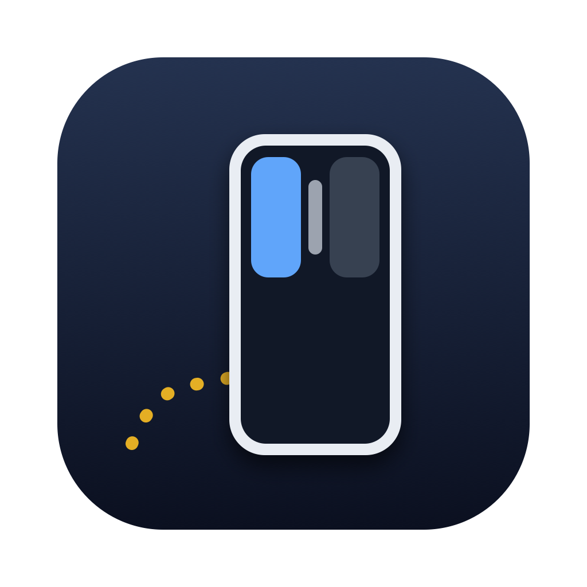

<p align="center"></p>

<h1 align="center">iPhone Mouse</h1>

<p align="center"><b>Turn your iPhone into a mouse for your Mac.</b><br>
Slide the phone on the desk and the Mac's cursor moves. Three different ways to do it, side by side.</p>

> Türkçe özet aşağıda: [Türkçe](#türkçe)

An iPhone app can't pretend to be a Bluetooth mouse: iOS doesn't let apps advertise themselves as a mouse (HID).
So this project has two parts:

- **iPhone app** (`iOS/`): works out how the phone moves and sends small UDP packets over your Wi-Fi.
- **Mac app** (`Mac/`): finds the phone with Bonjour, receives the packets and moves, clicks and scrolls the
  real cursor. To macOS it looks like an ordinary mouse.

Both apps share one packet format: `iOS/Fare/FareProtokol.swift`.

---

## The three modes

| Mode | How it knows where the phone went | Clicks | Result |
|---|---|---|---|
| **Face-down (camera)**: phone face-down | The back camera looks at the **ceiling**. ARKit tracks spots on it and gives the phone's position in millimetres. Lifting the phone stops the cursor, like a real mouse. | Volume up = left click, volume down = right click, or tap the back of the phone | Works, feels like a real mouse. Needs some light and a ceiling with a bit of texture. |
| **Touchpad**: the screen is a trackpad | Fingers on the screen, like a MacBook trackpad | Tap = left, two-finger tap = right, two-finger drag = scroll, tap then drag = drag and drop | Works best. Portrait or landscape (it turns by itself). |
| **Face-up (sensor)**: phone face-up | Only the **accelerometer**: push → speed → distance. The speed is reset every time the phone stops, so errors don't pile up. | On-screen left/right buttons, a scroll strip in the middle | **Doesn't really work.** The camera bump makes the phone sit crooked on the desk and the tiny sensor errors still win. Kept in as the honest failure. A "Face-down" option lets it lie screen-down, which helps a little. |

## Install

You need a Mac with Xcode, an iPhone on iOS 17 or newer, and macOS 14 or newer. A free Apple ID is enough to put the app
on your own phone.

**Mac app**

```bash
Mac/build.sh
```

Then move `Mac/build/iPhone Fare.app` to Applications and open it. The first time, macOS asks for
**Accessibility** permission (System Settings → Privacy & Security → Accessibility). Without it an app can't move
the cursor.

**iPhone app**

```bash
brew install xcodegen          # once
cp Config/local.env.example Config/local.env   # optional: your Team ID and bundle IDs
./generate.sh
open IPhoneFare.xcodeproj
```

Pick your team under Signing & Capabilities if you skipped `local.env`, then run it on your phone. Allow
**Local Network** (to find the Mac) and the **camera** (face-down mode).

## Using it

1. Phone and Mac on the same Wi-Fi. Open both apps. The Mac window shows "Phone connected" when they find each other.
2. On the phone pick a mode and press **Start**.
3. The Mac window shows the path the phone drew, the speed, the ceiling points in face-down mode, and the clicks. It also
   has a sensitivity slider and an optional yellow ring around the cursor (handy for filming).

## How it works (short)

- **Packets:** about 100 per second over UDP. Each one carries the position, buttons, scroll and click counters.
  Counters instead of "click now" events, so a lost packet never loses a click.
- **Face-down (camera):** ARKit world tracking with the camera facing up. When the phone is still, the desk height is
  re-learned. The phone counts as lifted 1.5 cm above it (with hysteresis), so it doesn't think it's "in the air"
  after sitting a while.
- **Face-up (sensor):** dead reckoning with zero-velocity updates. The sensor bias is learned only from still samples,
  speed is capped and every push has a time limit.
- **Touchpad:** a UIKit multi-touch view. A single tap waits 0.22 s, so that tap-then-drag isn't read as a double click.
- The movement math (`iOS/Fare/FareIzleyici.swift`) has no UIKit or ARKit in it, so it is tested on the Mac with
  simulated data:

```bash
swiftc -O -o /tmp/fare-deneme Tests/main.swift iOS/Fare/FareIzleyici.swift && /tmp/fare-deneme
```

## Extras

- `tools/hedef.html`: a 10-target click race page, the same targets every time, to compare a real mouse with the
  three modes.
- The Mac app writes a small CSV log of the session to `~/Library/Logs/iPhoneFare/`, useful when a mode misbehaves.

## Language

Both apps speak **English and Turkish**. By default they follow the device language (Turkish if the device is in
Turkish, English otherwise). Change it on the iPhone under the gear icon (**Settings → Language**) and on the Mac with
the language picker at the bottom of the window. The code comments are in Turkish.

---

## Türkçe

iPhone'u Mac'in faresine çeviren deneme. iPhone'da bir uygulama kendini Bluetooth fare diye tanıtamıyor. Bu yüzden
telefon hareketini Wi-Fi'dan Mac'teki küçük bir uygulamaya yolluyor, imleci o uygulama oynatıyor.

- **Ters (kamera):** Telefon ters duruyor, arka kamera tavanı görüyor ve ARKit telefonun yerini milimetre milimetre
  buluyor. Tık için ses tuşları ya da telefonun sırtına vurmak. Gerçek fare hissi veriyor.
- **Touchpad:** Ekran MacBook trackpad'i gibi çalışıyor. En rahatı bu.
- **Düz (sensör):** Sadece ivme sensörüyle çalışıyor. Kameranın çıkıntısı yüzünden telefon masada yamuk durduğu için
  düzgün çalışmadı. Dürüst başarısızlık olarak repoda duruyor.

Uygulamalar Türkçe ve İngilizce: iPhone'da dişli simgesi → Dil, Mac'te pencerenin altındaki dil seçimi.

Kurulum: `Mac/build.sh` ile Mac uygulamasını derle, Erişilebilirlik izni ver. `./generate.sh` ile Xcode projesini
oluştur ve telefona yükle. İkisi aynı Wi-Fi'da olsun.

## License

MIT. See [LICENSE](LICENSE).
